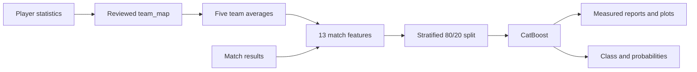
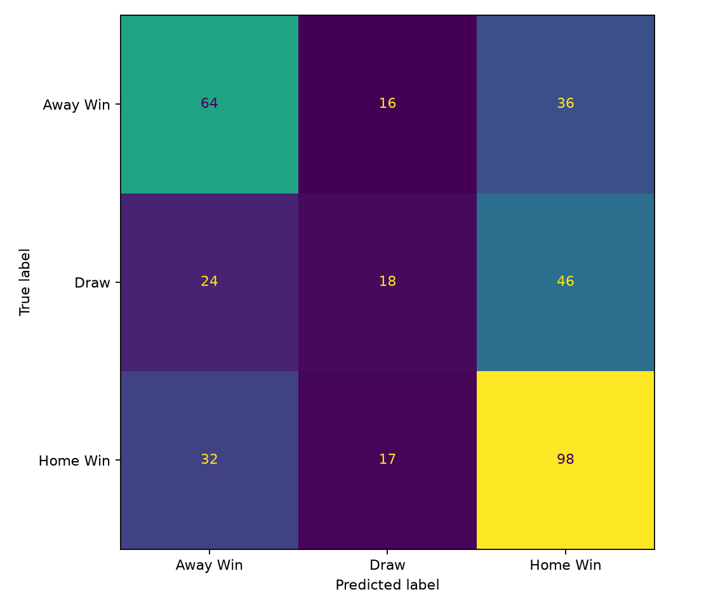
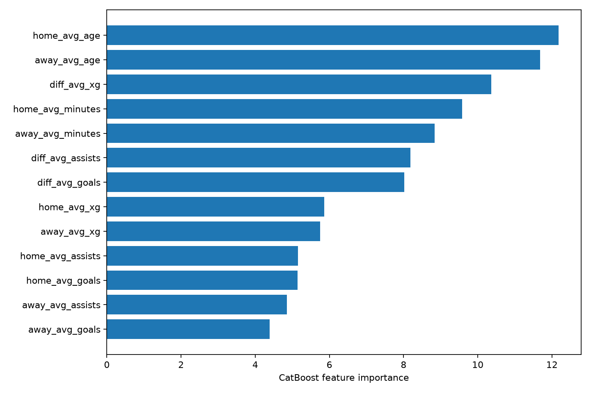

# Football Match Outcome Prediction

**Python · Pandas · CatBoost · Feature Engineering · Multiclass Classification**

A portfolio project based on Durbek Erkinov's 2026 bachelor thesis,
*Application of Machine Learning Algorithms for Analysis and Prediction of Football Match Results*.
It transforms seasonal player statistics into team features and predicts
**Home Win**, **Draw**, or **Away Win**, with a probability for each class.

**Measured accuracy: 51.28% on 351 held-out matches**, using the 13 predictors
listed in the thesis. The pipeline was trained and prediction was exercised on
the user's supplied project data on 2026-11-03. Macro F1: **0.4669**.
This is a retrospective random-split experiment, not a future-match backtest.

[Русская инструкция](README.ru.md) · [Experiment report](reports/EXPERIMENT.md) ·
[Data contract](data/README.md) · [Source traceability](docs/PROVENANCE.md) ·
[Validation](VALIDATION.md)

## Problem and implementation

The thesis combines two types of data: player statistics and match results for
2024/2025. This repository provides input validation, explicit club-name mapping,
player-to-team aggregation, a shared training/inference feature builder, CatBoost
training, saved model bundles, measured reports, and class-probability inference.



## Verified data and results

The supplied archive contains **2,854 player rows**, **96 teams**, and **1,941
matches**. Its original training script drops rows with incomplete predictors or
targets. Exactly **189 Champions League rows** have missing home and away
statistics; the retained **1,752 matches** cover the Premier League, La Liga,
Serie A, Bundesliga, and Ligue 1.

The adapter reproduces that exclusion policy and records excluded match IDs.
Rebuilt team averages and match features agree with the supplied tables within
`1e-10` numerical tolerance. Eight missing player ages are skipped only when
computing the age mean, consistent with pandas aggregation and the saved data.

| Version | Predictors | CatBoost seed | Train / test rows | Test accuracy |
|---|---:|---|---|---:|
| Thesis method, implemented here | 13 | Library default (recorded in metadata) | 1,401 / 351 | 51.28% |
| Supplied archive, unmodified code | 24 | 42 | 1,401 / 351 | 49.86% |

The thesis itself reports approximately 60%. Its appendix and the later supplied
archive differ: the archive additionally uses xAG, matches played, starts, and
more differences. The main pipeline preserves the thesis's **13-feature** scope.
Both runs use the same retained matches and split; because their features and
model seeds differ, this comparison does not isolate a feature-only effect.





See [EXPERIMENT.md](reports/EXPERIMENT.md) for per-class results and limitations.

## Exact method

`players["Squad"].replace(team_map)` maps player club names to match club names.
Each team is represented by unweighted column-wise player means:

| Player column | Team feature |
|---|---|
| `Gls` | `avg_goals` |
| `Ast` | `avg_assists` |
| `xG` | `avg_xg` |
| `Age` | `avg_age` |
| `Min` | `avg_minutes` |

Predictors are five `home_` values, five `away_` values, and home-minus-away
differences for goals, assists, and xG. No score, points, result column, team
identifier, or date is used as a model feature.

CatBoost settings: `iterations=700`, `learning_rate=0.04`, `depth=6`,
`loss_function="MultiClass"`, `eval_metric="Accuracy"`.
The split is `test_size=0.2`, `random_state=42`, `stratify=y`.
No test-set tuning, early stopping, or extra model seed is introduced.

## Reproduce the run

The verified run used **Python 3.14.8 on Windows**. Exact installed
dependencies are in `requirements-lock.txt`; the shorter `requirements.txt`
lists direct dependencies. Run commands from the repository root.

```powershell
python -m venv .venv
.\.venv\Scripts\Activate.ps1
python -m pip install -r requirements-lock.txt
```

On macOS/Linux, activate with `source .venv/bin/activate`. That platform has not
been tested; use a Python version supported by the packages.

Extract the original `football_match_prediction_project.rar` separately. Point
the adapter to the directory containing its five CSVs (the archive has nested
project directories). Replace the example path below with your actual path:

```bash
python -m src.prepare_archive --source "PATH/TO/ORIGINAL/data" --output data/prepared
python -m src.train --players data/prepared/players.csv --matches data/prepared/matches.csv --team-map data/prepared/team_map.json --output artifacts/thesis13
python -m src.predict --bundle artifacts/thesis13 --home "Arsenal FC" --away "Chelsea FC"
```

The preparation and training destinations must be new or empty. For a repeat
training run, choose a new directory such as `artifacts/thesis13-run2` and use it
with `--bundle`. Predict using exact match-dataset names in the saved statistics.
Unknown teams raise a clear error. Probabilities are keyed by `model.classes_`.

For other verified input tables, `src.train` can be used directly with the
[documented schema](data/README.md), an explicit `team_map`, and optional
`--target-column` / `--result-map`. The four-pair example mapping is illustrative;
the archive adapter imports the actual 96-entry mapping.

## Outputs and repository

```text
src/                 preprocessing.py, features.py, prepare_archive.py, train.py, predict.py
data/                input contract and example mapping; local prepared inputs are ignored
reports/             measured metrics, class report, matrix, importances, run metadata
images/              measured confusion matrix and feature importance
docs/PROVENANCE.md   mapping from implementation to thesis and supplied source
notebooks/README.md  analysis workflow
requirements.txt    direct dependencies
requirements-lock.txt  exact dependencies from the verified run
NOTICE               attribution and distribution status
VALIDATION.md        checks and their limits
```

Each local training bundle contains `model.cbm`, `team_strength.csv`, the input
mappings, reports, graphs, held-out predictions with row/match IDs, and metadata
with feature order, actual parameters, input hashes, versions, and split indices.
`data/` inputs and `artifacts/` bundles are ignored by Git and excluded from the
GitHub-ready ZIP. Reproducing the experiment requires the supplied original data.

## Limitations

Full-season aggregates may include information from after each match; the random
split therefore does not establish prospective forecasting ability. No pre-match
snapshot timestamps are provided. Match lineups, injuries, recent form and
fixture congestion are not features. The dataset excludes all Champions League
rows in this run, so these results describe the five retained domestic leagues.

The historical environment used for the thesis remains unknown. The measured
run is a documented reconstruction, not proof of bit-for-bit reproduction of the
original thesis experiment. Data-provider identities and redistribution terms
are not established by the attached archive. No original CSVs are included in
the public package. See [NOTICE](NOTICE).

Author of the source thesis: **Эркинов Дурбек Кахрамон угли (Durbek Erkinov)**,
Lomonosov Moscow State University, Tashkent branch, 2026.
