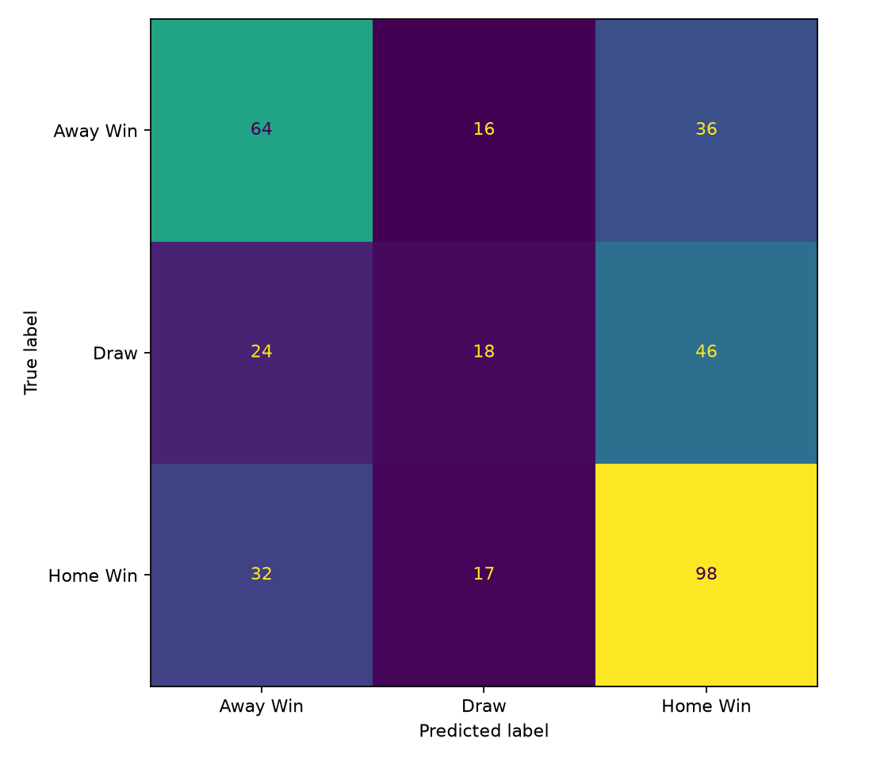
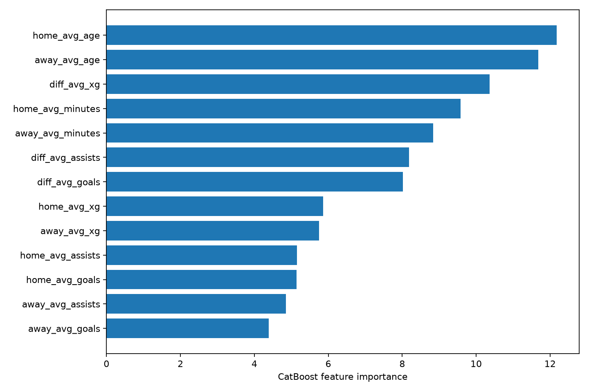

# Прогнозирование исходов футбольных матчей

Проект по прогнозированию исходов футбольных матчей на основе сезонной статистики игроков. Реализованы подготовка данных, формирование командных признаков, обучение CatBoost и прогнозирование трёх исходов: победа хозяев, ничья и победа гостей.

Работа основана на ВКР Дурбека Эркинова. Репозиторий содержит код, результаты проведённого эксперимента и графики оценки модели.

## Результаты

**Модель с 13 признаками из ВКР: accuracy 51,28%, macro F1 — 0,4669.**

Обучающая выборка содержит 1 401 матч, тестовая — 351 матч. Использовано стратифицированное разбиение 80/20 с `random_state=42`.

Исходная программа из архива с 24 признаками показала accuracy 49,86% на тех же тестовых матчах. Она также использует другой seed модели, поэтому разницу результатов нельзя приписать только дополнительным признакам.

Указанная в ВКР точность около 60% в этом эксперименте не воспроизвелась.

## Данные и подготовка

- Исходные таблицы содержат 2 854 строки игроков, 96 команд и 1 941 матч.
- 189 матчей Лиги чемпионов имеют пропуски в признаках команд. Они исключены по правилу исходного кода; осталось 1 752 матча пяти национальных лиг.
- Названия клубов между таблицами сопоставляются с помощью `team_map`.
- Средние показатели команд восстановлены из статистики игроков и сверены с сохранёнными таблицами.
- Восемь пропущенных значений возраста игнорируются только при вычислении среднего возраста. Остальные показатели этих игроков участвуют в расчёте соответствующих средних.
- Исключённые матчи и результаты проверок фиксируются при подготовке данных.

Подробности приведены в [описании данных](data/README.md).

## Признаки и модель

Для каждой команды рассчитываются пять средних показателей:

| Признак | Описание |
|---|---|
| `avg_goals` | Среднее количество голов игроков |
| `avg_assists` | Среднее количество ассистов |
| `avg_xg` | Средний показатель ожидаемых голов |
| `avg_age` | Средний возраст игроков |
| `avg_minutes` | Среднее игровое время |

Модель использует 13 признаков: по пять для домашней и гостевой команды и три разности «хозяева минус гости» — по голам, ассистам и xG.

Параметры `CatBoostClassifier`:

```python
iterations=700
learning_rate=0.04
depth=6
loss_function="MultiClass"
eval_metric="Accuracy"
```

Счёт матча, набранные очки и целевой исход не используются как входные признаки. Тестовая выборка не применяется для ранней остановки или выбора лучшей итерации.

## Оценка модели

Для оценки используются accuracy, classification report, confusion matrix и feature importance.

### Матрица ошибок



### Важность признаков



Подробные результаты доступны в [отчёте об эксперименте](reports/EXPERIMENT.md).

## Запуск

Проверенное окружение: **Python 3.14.8, Windows**. Версии установленных зависимостей сохранены в `requirements-lock.txt`.

Откройте PowerShell в корне репозитория, создайте виртуальное окружение и установите зависимости:

```powershell
python -m venv .venv
.\.venv\Scripts\Activate.ps1
python -m pip install -r requirements-lock.txt
```

### Подготовка данных

Исходные датасеты и обученная модель не включены в репозиторий. Для воспроизведения эксперимента необходим исходный архив с данными; публичная ссылка на него пока не предоставлена. Состав файлов и требования к данным описаны в [data/README.md](data/README.md).

Распакуйте исходный архив отдельно. В следующей команде замените пример пути на путь к его папке `data`, содержащей CSV:

```powershell
python -m src.prepare_archive --source "ПУТЬ/К/ИСХОДНОМУ/ПРОЕКТУ/data" --output data/prepared
```

Скрипт подготовит входные таблицы, импортирует соответствия команд и сохранит отчёт о проверках и исключённых матчах. Папка назначения должна быть новой или пустой.

### Обучение

```powershell
python -m src.train --players data/prepared/players.csv --matches data/prepared/matches.csv --team-map data/prepared/team_map.json --output artifacts/thesis13
```

После обучения в `artifacts/thesis13/` сохраняются модель, статистики команд, метрики, графики и сведения о запуске.

Для повторного обучения укажите новую папку через `--output`, например `artifacts/thesis13-run2`.

### Прогноз

```powershell
python -m src.predict --bundle artifacts/thesis13 --home "Arsenal FC" --away "Chelsea FC"
```

Названия команд должны точно совпадать с названиями в сохранённом `team_strength.csv`. Параметр `--bundle` указывает на папку с результатами соответствующего обучения.

Программа выводит JSON с прогнозируемым классом и вероятностями трёх исходов. Если команда отсутствует в сохранённых данных, программа сообщает об ошибке.

## Структура репозитория

```text
src/
    preprocessing.py       Проверка данных и сопоставление команд
    features.py            Агрегация статистик и формирование признаков
    prepare_archive.py     Подготовка данных из исходного архива
    train.py               Обучение и оценка модели
    predict.py             Прогноз класса и вероятностей

data/                      Описание входных данных и пример team_map
reports/                   Метрики, отчёты и сведения об эксперименте
images/                    Матрица ошибок и важность признаков
docs/PROVENANCE.md          Связь реализации с ВКР и исходным проектом
notebooks/README.md         Описание возможного анализа в ноутбуке

requirements.txt           Основные зависимости
requirements-lock.txt      Версии пакетов проверенного окружения
VALIDATION.md              Результаты проверок
NOTICE                     Сведения об источниках и статусе лицензирования
```

Локальные входные данные в `data/prepared/` и результаты обучения в `artifacts/` исключены из Git. В `reports/` и `images/` сохранены отчёты и графики проведённого эксперимента.

## Ограничения

Сезонные признаки могут содержать информацию, которая ещё не была доступна перед конкретным матчем. Вместе со случайным разбиением это создаёт риск временной утечки данных.

Поэтому **51,28% — результат ретроспективного эксперимента, а не подтверждённая точность прогнозирования будущих матчей**. Для такой оценки потребуются статистики, доступные до каждого матча, и хронологическое разделение данных.

Модель не учитывает фактические составы, травмы, дисквалификации, текущую форму и календарную нагрузку. Результаты относятся к пяти национальным лигам, оставшимся после исключения матчей с пропусками.

Отдельная калибровка вероятностей не проводилась.

## Автор

**Эркинов Дурбек Кахрамон угли**

Проект основан на ВКР «Применение алгоритмов машинного обучения для анализа и прогнозирования результатов футбольных матчей», 2026.

[Полный отчёт](reports/EXPERIMENT.md) · [Проверки](VALIDATION.md) · [Связь с ВКР и исходным проектом](docs/PROVENANCE.md) · [English README](README.md)
